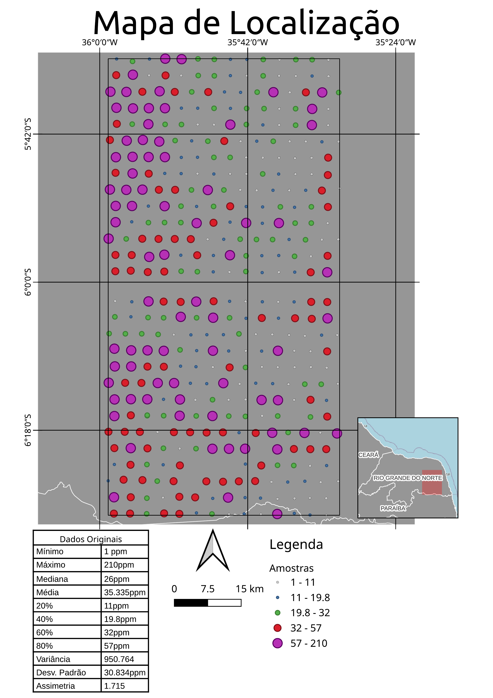
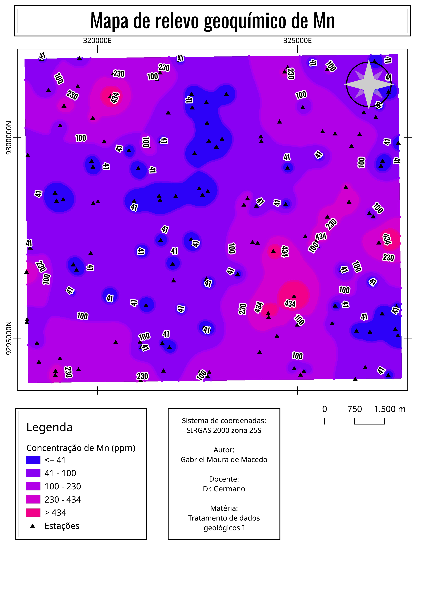
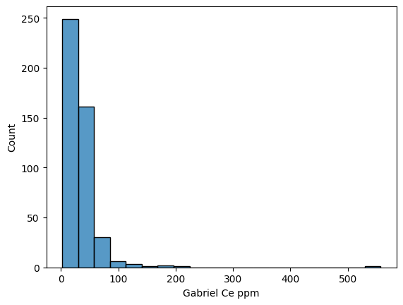
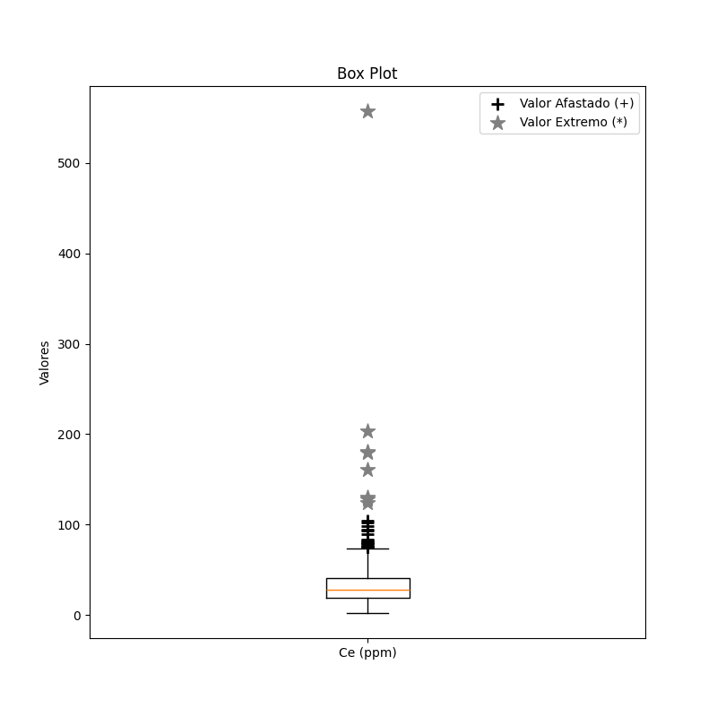
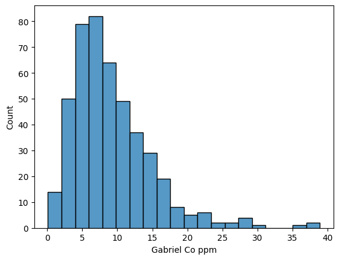
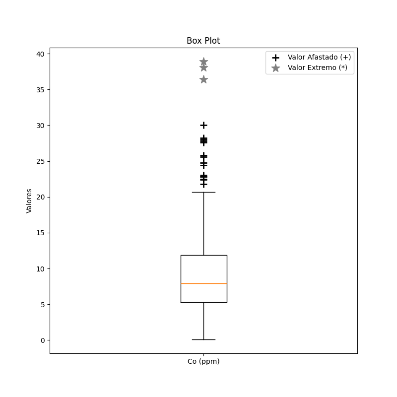
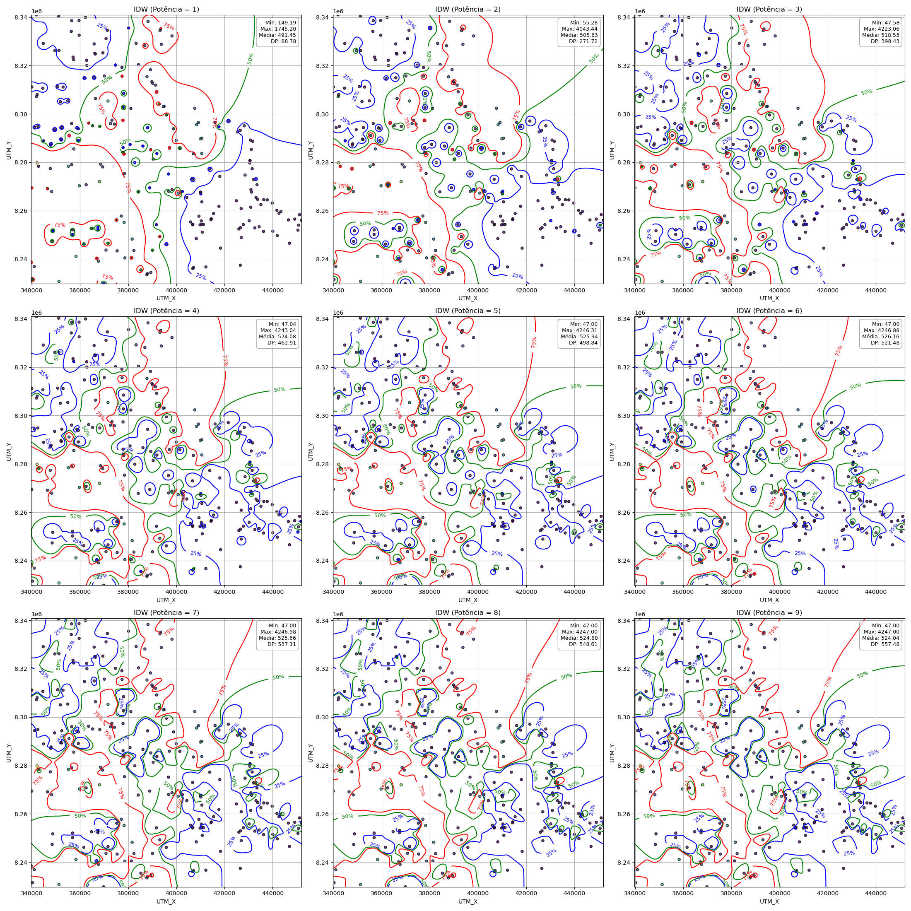
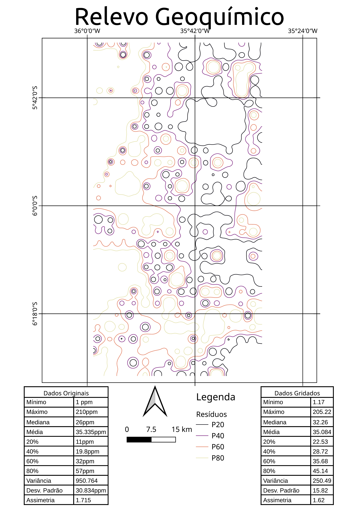
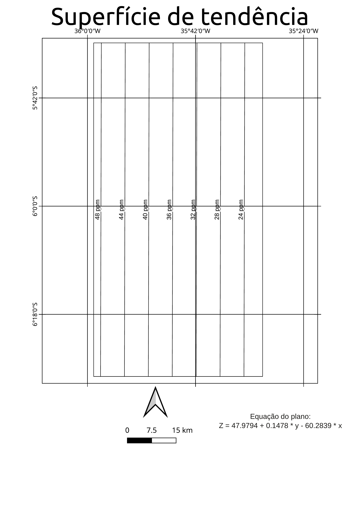
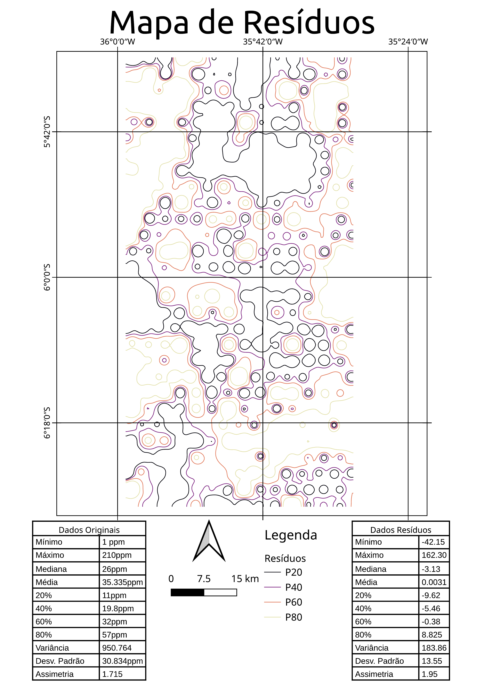

When a sample contains a high concentration of metal, the surrounding samples give that measurement context. Are their concentrations high as well? Or does this sample stand out in an area where concentrations are usually low? In the Geological Data Analysis I course at the Federal University of Rio Grande do Norte (UFRN), I used Python and QGIS to investigate these questions with geochemical data.

## Where were the samples collected?

Each sample pairs a location with a measured concentration. For concentrations expressed in parts per million (ppm) by mass, 1 ppm means 1 mg of the element per kilogram of material. To work with distances between the 272 zinc (Zn) samples, I used coordinates in metres in the SIRGAS 2000 / UTM zone 24S reference system.

On the zinc map, the legend runs from small pale circles for concentrations of 1 to 11 ppm to large magenta circles for 57 to 210 ppm. In the northwest, several magenta circles sit side by side along rows of stations. High concentrations recur at neighbouring sites there. Across the centre, the gaps between symbols widen. In those stretches, the nearest measurement available for comparison is farther away.

## From sample measurements to a continuous map

I began by plotting histograms and box plots for zinc and manganese (Mn). A histogram counts the samples in each concentration range. A box plot summarises the distribution using **percentiles**. For example, the median (P50) divides the ordered measurements in half. This gives a point of reference for deciding which values deserve a closer look. I also used percentile classes and box-plot outlier thresholds when mapping cerium (Ce) and cobalt (Co).

For zinc, the gap between the median (26 ppm) and the mean (35.3 ppm) helps explain the colours on the first map. Half the samples contain at most 26 ppm, but a few reach as high as 210 ppm and pull the mean upwards. The magenta class begins at 57 ppm, the 80th percentile. It therefore represents roughly the highest fifth of the samples, even though it spans a much wider concentration range than the other classes.

The manganese map fills in a detail left open by the point map. Black triangles locate the stations, and the colour between them represents estimated concentration. Purple covers much of the map, broken by blue patches of lower concentration. In the southeast, a small patch of bright pink marks estimates above 434 ppm. Following its edge and then looking back at the triangles shows where measurements help define the shape of that patch.

## What makes a concentration unusual?

For cerium (Ce), the histogram shows why a single value such as the mean tells only part of the story. Each bar counts samples within a concentration range. The first two bars, below roughly 60 ppm, account for most observations. Frequencies then drop sharply. After a long empty stretch, one small bar appears beyond 500 ppm.

The box plot places that observation in the context of the whole dataset. The box holds the middle half of the measurements, and the orange line marks the median. Above the upper whisker, crosses mark outliers and stars identify extreme values. The highest star, near 557 ppm, corresponds to the isolated bar at the far end of the histogram.

Cobalt (Co) has a different distribution. The bars rise to a peak around 6 to 8 ppm, then decline over several consecutive intervals. As with cerium, there is a tail to the right, but here the transition from common to rare concentrations plays out on a scale reaching only about 40 ppm.

In the cobalt box plot, the middle half of the measurements falls between about 5 and 12 ppm. The upper whisker reaches roughly 21 ppm. Beyond it, crosses extend to 30 ppm and a small group of stars sits between 36 and 39 ppm. To see whether those high measurements also occur together in the field, we need to return to the sampling locations.

The four maps in the PDF compare box-plot and percentile classifications for each element. Each station stays in the same place across the two versions. What changes is the concentration it takes for a station to receive a larger symbol. On the cerium maps, for instance, several large green circles cluster in the southeast, a pattern the histogram alone cannot locate. [View the four cerium and cobalt maps (PDF)](/portfolio/tdg2/mapa.pdf).

## How much should distance matter?

To estimate concentrations between samples, I tested **inverse distance weighting (IDW)**. The method takes a weighted average of nearby measurements. The power controls how quickly a sample loses influence as its distance from the prediction location increases. [Esri’s explanation of IDW](https://pro.arcgis.com/en/pro-app/3.6/help/analysis/geostatistical-analyst/how-inverse-distance-weighted-interpolation-works.htm).

Consider a location between two stations, one 1 km away and the other 2 km away. At power 1, the nearer station receives twice the weight of the farther one. At power 2, it receives four times the weight. If the two measurements differ substantially, changing the power can shift a contour even though both measurements stay the same.

Power increases across each row of panels, from top left to bottom right. The black points mark the same stations in every panel. Follow the blue line across the lower half of the plots, for example. At power 1, large spaces separate the contours. In later panels, small closed loops appear near the points. These are details that emerge as the estimate becomes more sensitive to its immediate neighbours.

## What stands out against the regional pattern?

On the geochemical relief map, *relief* refers to the highs and lows of zinc concentration. Drawing the contours first requires an estimate at each location on a grid covering the area. The table on the right summarises those grid values. Their 80th percentile is 45.14 ppm, below the 57 ppm obtained from the original samples. Each station counts once in the sample distribution. On the grid, a large area contributes many cells even if it contains few stations. Which dataset supplies the percentile therefore matters when comparing contours.

To describe how concentration varies across the whole area, I fitted a plane to the data. On the **trend surface** map it appears as a series of nearly vertical straight lines. Following one of these lines from north to south keeps the predicted concentration constant. Travelling from west to east takes you through successive concentration levels. Two stations with the same measured concentration can therefore stand out to different degrees, depending on the prediction for each location.

Finally, I calculated each station’s **residual** by subtracting the value predicted by the plane from its measured concentration. The table on the right shows how far individual observations departed from that baseline. At one extreme, a station fell 42.15 ppm below the regional prediction. At the other, the measurement exceeded the prediction by 162.30 ppm. The mean residual was close to zero because positive and negative differences offset each other.

The contours show how those differences vary across space after interpolation. Here the yellow P80 line corresponds to a residual of about +8.83 ppm. Along it, zinc concentration is estimated to be nearly 9 ppm above the baseline for each location. This makes it possible to look for local enrichment even in areas where absolute concentrations are relatively low.

For field follow-up, I would prioritise an area where several neighbouring samples exceed the trend and check how those measurements relate to the local geology. An isolated peak surrounded by few measurements would first call for closer sampling.

**Tools used:** Python, Pandas, NumPy, GeoPandas, Matplotlib, Seaborn, Jupyter Notebook and QGIS.
