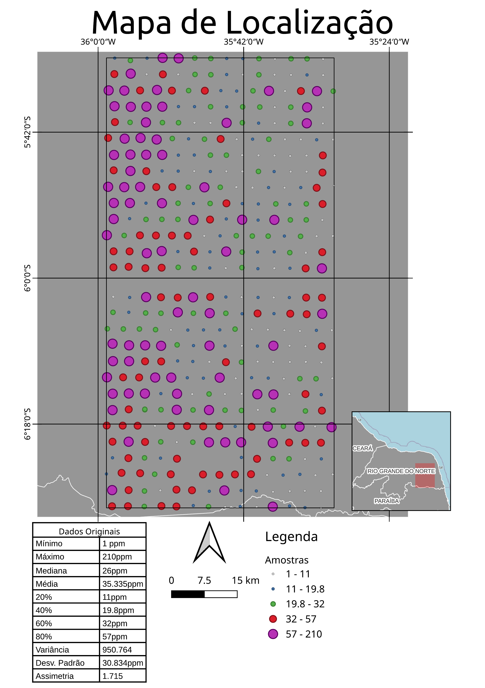
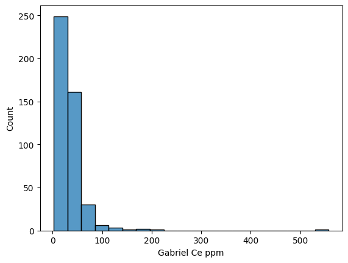
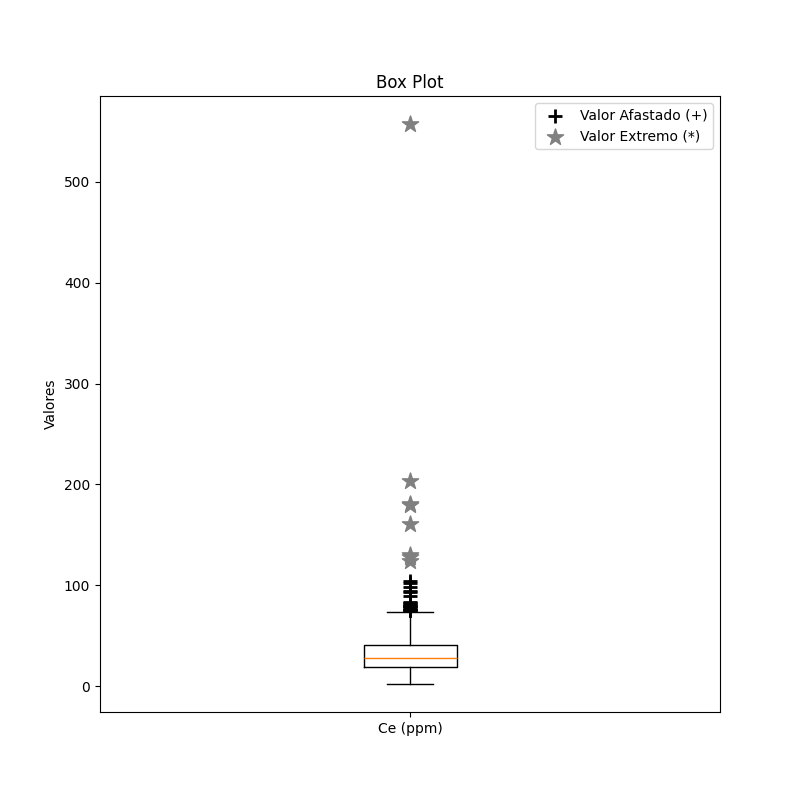
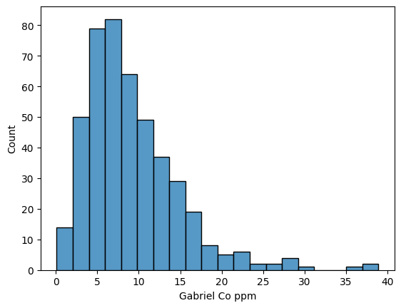
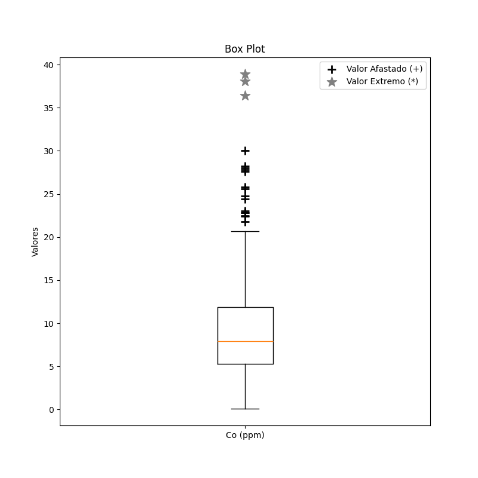
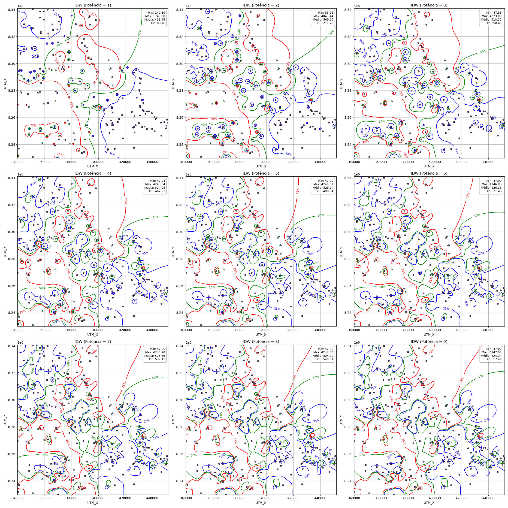
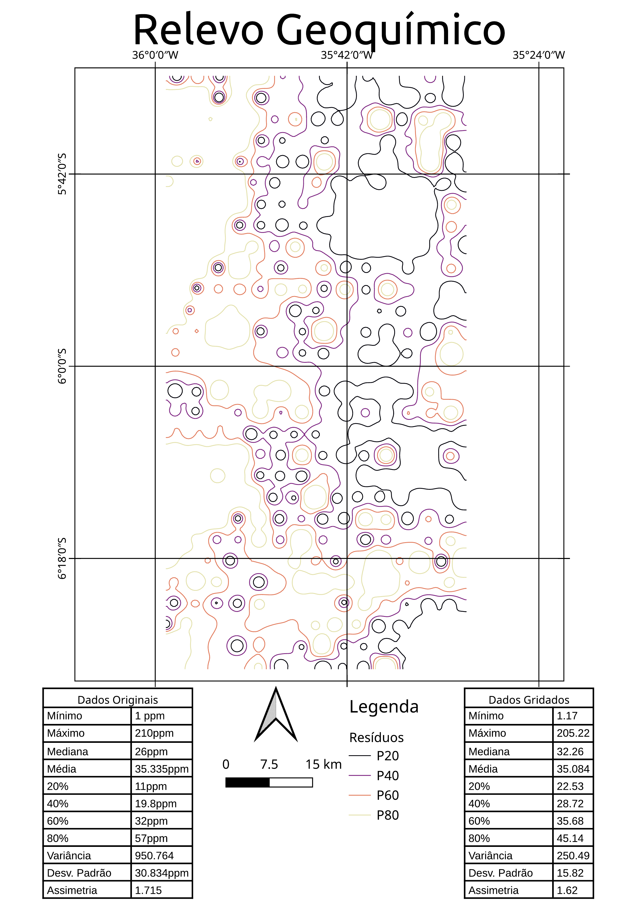
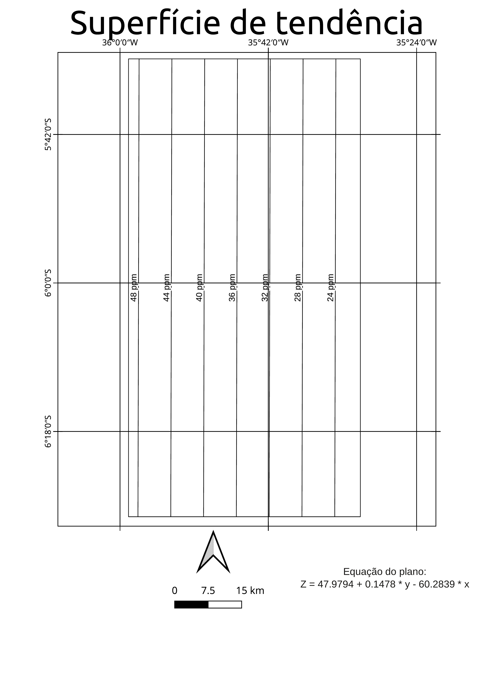
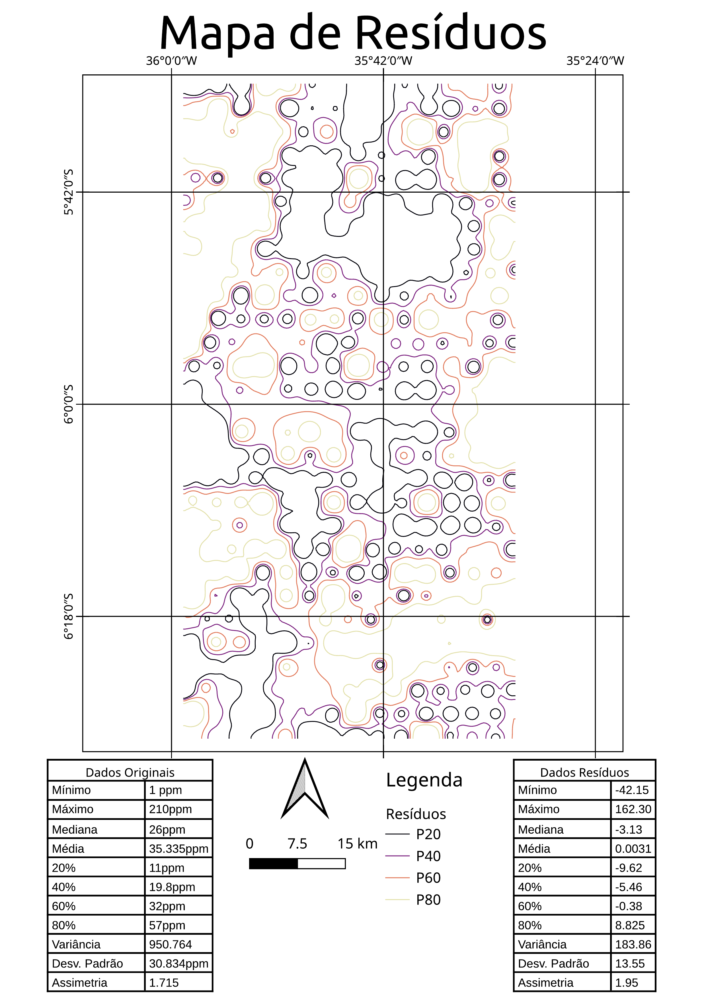

Quando uma amostra apresenta um teor elevado de metal, faz diferença saber o que acontece ao redor dela. O valor também é alto nas amostras vizinhas? Ou ele se destaca em uma área onde os teores costumam ser baixos? Na disciplina de Tratamento de Dados Geológicos I da UFRN, usei Python e QGIS para investigar essas perguntas com dados geoquímicos.

## Onde estão as amostras?

Cada amostra associa uma posição a uma medida de concentração, ou **teor**. Quando o teor é expresso em partes por milhão (ppm) em massa, 1 ppm equivale a 1 mg do elemento por quilograma de material. Para analisar as distâncias entre as 272 amostras de zinco (Zn), trabalhei com coordenadas em metros no sistema SIRGAS 2000 / UTM zona 24S.

No mapa de zinco, a legenda vai de pequenos círculos claros, para teores entre 1 e 11 ppm, a círculos magenta maiores, para teores entre 57 e 210 ppm. No noroeste, vários círculos magenta aparecem lado a lado em fileiras de estações. Ali, o teor elevado se repete em pontos próximos. Já na faixa central há intervalos maiores entre os símbolos. Nesses trechos, é preciso percorrer uma distância maior até encontrar outra medida com a qual comparar a primeira.

## Do teor medido ao mapa contínuo

Comecei a análise de zinco e manganês (Mn) com histogramas e diagramas de caixa. O histograma mostra quantas amostras caem em cada faixa de concentração. O diagrama de caixa resume a distribuição por **percentis**. Por exemplo, a mediana (P50) divide os dados ordenados ao meio. Essa leitura ajuda a distinguir um teor comum de um valor que merece ser examinado. Também apliquei classes de percentis e limites de valores atípicos ao mapeamento de cério (Ce) e cobalto (Co).

No zinco, a diferença entre a mediana (26 ppm) e a média (35,3 ppm) ajuda a ler as cores do primeiro mapa. Metade das amostras tem até 26 ppm, mas alguns teores chegam a 210 ppm e puxam a média para cima. O limite de 57 ppm que marca o início da classe magenta corresponde ao percentil 80. Essa classe, portanto, reúne aproximadamente o quinto superior das amostras, embora cubra uma faixa de teores muito mais larga que as demais.

O mapa de manganês acrescenta uma informação que o mapa de pontos deixava em aberto. Os triângulos pretos localizam as estações, e a cor entre eles representa o teor estimado. Predominam os tons de roxo, entrecortados por manchas azuis de teores mais baixos. No setor sudeste, uma pequena área rosa intensa marca teores acima de 434 ppm. É possível seguir sua borda com o olhar e voltar aos triângulos para ver onde há medidas que sustentam a forma da mancha.

## Como reconhecer um teor incomum?

Para o cério (Ce), o histograma mostra por que um único valor, como a média, conta apenas parte da história. Cada barra reúne amostras de uma faixa de concentração. As duas primeiras barras, abaixo de aproximadamente 60 ppm, concentram a maior parte das observações. À direita, a frequência cai rapidamente. Depois de um longo intervalo vazio, uma pequena barra reaparece acima de 500 ppm.

O diagrama de caixa permite localizar essa observação em relação às demais. A caixa contém a metade central das amostras e a linha laranja marca a mediana. Acima do limite da haste superior, o gráfico usa cruzes para valores afastados e estrelas para os extremos. A estrela mais alta, perto de 557 ppm, corresponde à barra isolada na ponta do histograma.

O cobalto (Co) apresenta outra distribuição. As barras aumentam até um pico em torno de 6 a 8 ppm e depois diminuem ao longo de várias faixas consecutivas. Há uma cauda à direita, como no cério, mas é possível acompanhar a passagem dos teores frequentes para os mais raros em uma escala que chega a cerca de 40 ppm.

No diagrama de caixa do cobalto, a metade central das medidas fica aproximadamente entre 5 e 12 ppm. A haste superior chega perto de 21 ppm. Acima dela, há uma sequência de cruzes até 30 ppm e um pequeno grupo de estrelas entre 36 e 39 ppm. Para investigar se essas medidas altas ocorrem juntas no terreno, o passo seguinte é voltar às coordenadas das amostras.

As quatro pranchas do PDF permitem comparar, para cada elemento, a classificação pelo diagrama de caixa com a classificação por percentis. Os pontos ocupam as mesmas posições nas duas versões de cada mapa. O que muda é o teor necessário para que uma estação receba um símbolo maior. Nos mapas de cério, por exemplo, vários círculos verdes grandes se concentram no sudeste, agrupamento que o histograma sozinho não permite localizar. [Ver os quatro mapas de cério e cobalto (PDF)](mapa.pdf).

## O que muda com a distância?

Para estimar valores entre amostras, testei a **ponderação pelo inverso da distância (IDW)**. O método calcula uma média ponderada dos teores vizinhos. A potência controla a rapidez com que a influência de cada amostra diminui com a distância. [Descrição do método IDW pela Esri](https://pro.arcgis.com/en/pro-app/3.6/help/analysis/geostatistical-analyst/how-inverse-distance-weighted-interpolation-works.htm).

Para entender o efeito da potência, imagine um local entre duas estações, uma a 1 km e outra a 2 km. Com potência 1, a estação mais próxima recebe o dobro do peso da mais distante. Com potência 2, recebe quatro vezes o peso. Se as duas registram teores muito diferentes, mudar a potência pode deslocar a isolinha mesmo que os valores medidos permaneçam idênticos.

Nos nove painéis, as potências aumentam da esquerda para a direita e de cima para baixo. Os pontos pretos permitem reencontrar as mesmas estações em cada quadro. Acompanhe, por exemplo, a curva azul na metade inferior dos painéis. Com potência 1 ela deixa grandes espaços entre os contornos. Nos painéis seguintes aparecem pequenas voltas fechadas perto dos pontos. A comparação mostra quais detalhes do mapa surgem quando a estimativa passa a depender mais dos vizinhos imediatos.

## O que se destaca em relação à vizinhança?

No mapa de relevo geoquímico, a palavra *relevo* descreve as subidas e descidas do teor de zinco. Para desenhar as curvas, primeiro é preciso estimar um teor em cada posição de uma grade que cobre a área. A tabela à direita resume esses valores. Nela, P80 equivale a 45,14 ppm, abaixo dos 57 ppm obtidos com as amostras originais. Cada estação conta uma vez na distribuição original. Na grade, uma região extensa contribui com muitas células, mesmo quando contém poucas estações. Por isso, é importante identificar de qual conjunto foi calculado o percentil antes de comparar duas curvas.

Para descrever como o teor varia na escala de toda a área, ajustei um plano às concentrações. O resultado aparece no mapa da **superfície de tendência** como uma sequência de retas quase verticais. Seguindo uma dessas retas de norte a sul, o teor previsto permanece constante. Ao percorrer o mapa de oeste a leste, cruzamos sucessivos níveis de concentração. Com essa referência, duas estações com o mesmo teor medido podem se destacar de maneiras diferentes, dependendo do valor previsto para cada posição.

Por fim, calculei o **resíduo** de cada estação, subtraindo do teor medido o valor previsto pelo plano. A tabela à direita do mapa mostra o alcance desses desvios. Em um extremo, uma estação ficou 42,15 ppm abaixo da previsão regional. No outro, o teor medido superou a previsão em 162,30 ppm. A média dos resíduos ficou próxima de zero, pois desvios positivos e negativos se compensam.

As curvas mostram onde esses desvios se distribuem depois da interpolação. Aqui, a curva amarela P80 corresponde a um resíduo de aproximadamente +8,83 ppm. Ao longo dela, estima-se que o teor esteja quase 9 ppm acima do esperado para cada posição. Essa leitura permite procurar enriquecimentos locais até em setores onde o teor absoluto é relativamente baixo.

Em uma investigação de campo, eu priorizaria uma área onde várias amostras vizinhas superam a tendência e verificaria sua relação com a geologia local. Um pico isolado cercado por poucas medições exigiria primeiro uma amostragem mais densa.

**Ferramentas utilizadas:** Python, Pandas, NumPy, GeoPandas, Matplotlib, Seaborn, Jupyter Notebook e QGIS.
