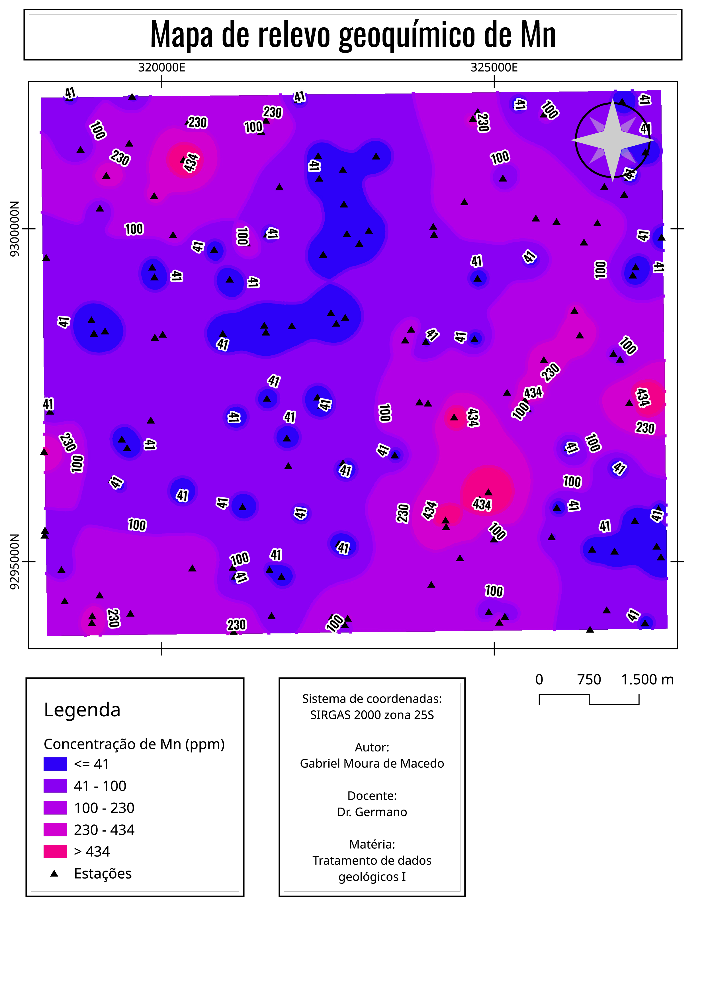

**Esse trabalho foi feito durante a matéria de tratamento de dados geológicos na UFRN**

Ao longo dessa matéria usamos dados de geoquímica para entender o comportamento deles frente aos diferentes tratamentos estatísticos

 na área de estudo.")

Durante a disciplina de Tratamento de Dados Geológicos I, desenvolvi atividades de tratamento, análise estatística e modelagem espacial de dados geoquímicos, utilizando **Python e QGIS** para investigar a distribuição de elementos químicos e identificar possíveis anomalias geoquímicas.

Inicialmente, realizei a análise exploratória de dados de **manganês (Mn) e zinco (Zn)**, aplicando técnicas de estatística descritiva, como cálculo de média, mediana, variância, desvio padrão, coeficiente de variação, assimetria e percentis. Foram elaborados histogramas e diagramas de caixa (*boxplots*) para avaliar a distribuição dos valores, a dispersão dos dados e a ocorrência de valores extremos.

Na etapa de análise espacial, trabalhei com o georreferenciamento de amostras geoquímicas, incluindo um conjunto de **272 amostras de Zn**, utilizando o sistema SIRGAS 2000 / UTM zona 24S. A partir desses dados, produzi mapas de distribuição geoquímica, mapas de isovalores e representações cartográficas baseadas em classes de concentração e percentis.

Também realizei experimentos de interpolação espacial utilizando o método do **Inverso da Distância Ponderada (IDW)**, comparando nove valores do parâmetro de potência, de 1 a 9. Essa análise permitiu avaliar a influência da potência sobre a superfície interpolada, observando diferenças na suavização espacial, no destaque de anomalias locais e na geometria das curvas de isovalores, incluindo os níveis correspondentes aos percentis de 25%, 50% e 75%.

Além disso, foram elaborados mapas geoquímicos de **cério (Ce) e cobalto (Co)**, utilizando classificações baseadas em percentis e limites de valores atípicos identificados por boxplots. Também foram desenvolvidas análises de tendência espacial, com ajuste de superfície de tendência, cálculo de resíduos e elaboração de mapas de resíduos e resíduos interpolados, visando distinguir padrões regionais de variações geoquímicas locais.

Essas atividades proporcionaram experiência prática na integração entre programação, estatística e Sistemas de Informações Geográficas (SIG), com aplicações na prospecção mineral, na análise de anomalias geoquímicas e na interpretação espacial de dados geológicos.

**Tecnologias utilizadas:** Python, Pandas, NumPy, GeoPandas, Matplotlib, Seaborn, Jupyter Notebook e QGIS.

**Competências desenvolvidas:** estatística descritiva, análise exploratória de dados, visualização científica, geoprocessamento, interpolação IDW, análise de sensibilidade de parâmetros, superfícies de tendência, análise de resíduos e cartografia geoquímica.
